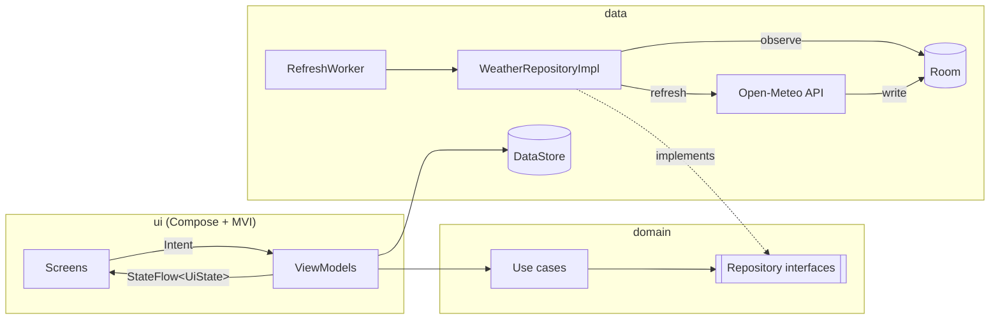

# Weather Now — offline-first Android weather app (Jetpack Compose)

[](https://github.com/trsimanto/android-weather/actions/workflows/android.yml)


A small, production-style Android app that shows current weather, the next 24 hours and a 7-day forecast for the cities you follow. It works **offline-first**: everything you've seen is cached in Room and shown instantly, with the network only used to refresh it.

No API key needed — data comes from the free [Open-Meteo](https://open-meteo.com/) API.

## Features

- 🌍 **Saved cities** — search any city (Open-Meteo geocoding) and add it to your list
- 🌤️ **Current conditions** — temperature, feels-like, humidity, wind, with weather emoji
- ⏱️ **Hourly forecast** for the next 24 hours and a **7-day forecast**
- 📴 **Offline-first** — cached data is shown instantly; an offline banner appears when a refresh fails
- 🔄 **Pull-to-refresh** with a "last updated" time
- 🌡️ **°C / °F toggle**, persisted with DataStore
- ⏰ **Background refresh** every 3 hours with WorkManager (only on a network connection)
- 🎨 **Material 3** with dynamic color (Android 12+), dark mode and edge-to-edge

## Tech stack

| Area | Choice |
| --- | --- |
| Language | Kotlin, Coroutines, Flow |
| UI | Jetpack Compose, Material 3, Navigation Compose |
| Architecture | MVI (immutable `UiState` + `Intent`), Clean-ish layers (data / domain / ui) |
| DI | Hilt (incl. `HiltWorkerFactory`) |
| Networking | Retrofit + OkHttp + kotlinx.serialization |
| Persistence | Room (single source of truth), DataStore Preferences |
| Background | WorkManager (periodic, network-constrained) |
| Testing | JUnit 4, kotlinx-coroutines-test, Turbine, hand-written fakes, Compose UI test |
| CI | GitHub Actions (unit tests + debug build) |

## Architecture



### How offline-first works

1. **Room is the single source of truth.** Screens never read from the network directly — they observe Room through `Flow`s.
2. **Refreshing writes into Room.** `refreshForecast()` fetches from Open-Meteo and upserts the result; the UI updates automatically because it's already observing the table.
3. **Failures keep the cache.** A failed refresh returns `Result.failure` and leaves the cached forecast untouched. The ViewModel shows an offline banner (cached data available) or an error state (nothing cached yet).
4. **Background sync.** `RefreshWorker` refreshes every saved city every 3 hours when the device is online, so the app usually opens with fresh data.

## Project structure

```
app/src/main/java/dev/towhid/weather/
├── data/
│   ├── local/        # Room entities, DAO, database
│   ├── remote/       # Retrofit API, DTOs, DTO → domain mappers
│   ├── repository/   # Offline-first WeatherRepositoryImpl
│   ├── settings/     # DataStore-backed settings
│   └── sync/         # WorkManager RefreshWorker
├── di/               # Hilt modules
├── domain/
│   ├── model/        # City, Forecast, WeatherCondition, TemperatureUnit
│   ├── repository/   # Repository interfaces
│   └── usecase/      # Small, single-purpose use cases
└── ui/
    ├── cities/       # Saved cities list
    ├── search/       # Add-city search (debounced)
    ├── forecast/     # City detail: current, hourly, daily
    ├── components/   # Shared composables
    └── theme/        # Material 3 theme
```

## Getting started

Requirements: Android Studio (latest stable), JDK 17, Android SDK with API 37.

```bash
git clone https://github.com/trsimanto/android-weather.git
cd android-weather
./gradlew installDebug
```

Or open the project in Android Studio and press **Run**. No API keys or extra setup needed.

## Testing

```bash
./gradlew testDebugUnitTest          # unit tests (JVM)
./gradlew connectedDebugAndroidTest  # Compose UI tests (device/emulator)
```

What's covered:

- `WeatherRepositoryImplTest` — caching, offline fallback, cascade delete, corrupt-cache handling (fake API + fake DAO)
- `CitiesViewModelTest`, `ForecastViewModelTest` — state transitions with Turbine and a test main dispatcher
- `WeatherConditionTest` — WMO weather-code mapping
- `TemperatureUnitTest` — °C/°F conversion and formatting
- `CitiesScreenTest` — Compose UI test for the empty state and unit toggle

## Roadmap

- [ ] Current-location weather (Fused Location Provider)
- [ ] Home-screen widget with Glance
- [ ] Severe-weather notifications
- [ ] Reorder cities with drag and drop
- [ ] Screenshot tests (Roborazzi / Paparazzi)
- [ ] Split into feature modules with convention plugins

## Credits

Weather data by [Open-Meteo.com](https://open-meteo.com/) (CC BY 4.0).

## Author

**Towhidur Rahman** — Lead Mobile Developer · [linkedin.com/in/trsimanto](https://www.linkedin.com/in/trsimanto)
